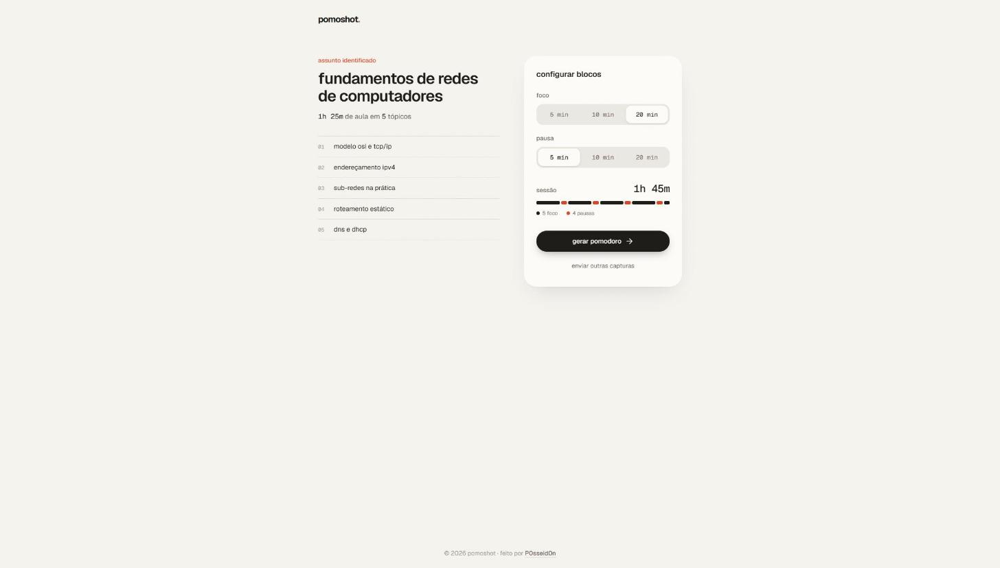
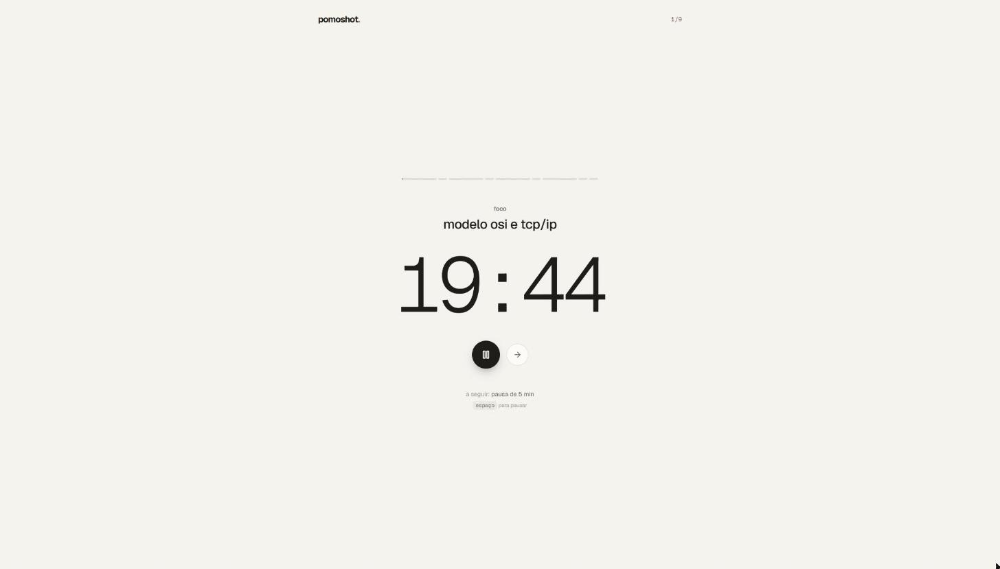

<div align="center">

# pomoshot.

Transforme capturas de tela das suas aulas em um plano de estudo pomodoro, montado por IA.

[pomoshot.p0sseid0n.dev](https://pomoshot.p0sseid0n.dev) · [Reportar bug](https://github.com/P0sseid0n/pomoshot/issues/new?template=bug.yml) · [Sugerir ideia](https://github.com/P0sseid0n/pomoshot/issues/new?template=feature.yml)


</div>

---

## Sobre

Você tira prints da lista de aulas de um curso (ou dos slides), envia para o pomoshot e ele:

1. lê as imagens com o **Gemini** e identifica o assunto, os tópicos e o tempo total de estudo;
2. deixa você escolher a duração dos blocos de foco e de pausa;
3. monta a sequência de blocos e roda o cronômetro, um tópico por bloco de foco.

<table>
  <tr>
    <td></td>
    <td></td>
  </tr>
  <tr>
    <td align="center"><sub>configuração dos blocos</sub></td>
    <td align="center"><sub>cronômetro</sub></td>
  </tr>
</table>

### Funcionalidades

- upload por clique, arrastar e soltar ou `ctrl+v`
- extração de assunto, tópicos e duração via Gemini (`gemini-2.5-flash`) com resposta em JSON validada
- configuração de foco e pausa com prévia da sessão
- cronômetro com barra de progresso por bloco, atalho de teclado (espaço), tempo no título da aba e som ao trocar de bloco
- modo escuro automático (segue o sistema)
- limite de uma extração por IP a cada hora, guardado no Redis

---

## Stack

| Pacote      | Tecnologias                                                |
| ----------- | ---------------------------------------------------------- |
| `frontend/` | React 19, TypeScript, Tailwind CSS v4, Vite, Eden Treaty   |
| `backend/`  | Bun, Elysia, Google GenAI SDK, TypeBox, Redis (rate limit) |

O repositório é um monorepo com **Bun Workspaces**. O frontend importa o tipo `App` do backend, então as chamadas à API são tipadas de ponta a ponta pelo Eden Treaty.

```
pomoshot/
├── backend/            API Elysia
│   └── src/
│       ├── modules/    rotas (lessons)
│       ├── services/   cache / rate limit no Redis
│       ├── lib/        clientes (Gemini, Redis)
│       └── errors/
├── frontend/           aplicação React
│   └── src/
│       ├── components/ screens, ui e icons
│       └── api/        cliente Eden Treaty
└── docker-compose.yml  Redis local
```

---

## Rodando localmente

### Pré-requisitos

- [Bun](https://bun.sh) 1.3+
- [Docker](https://www.docker.com/) (para o Redis), ou um Redis acessível
- uma chave da [API do Gemini](https://aistudio.google.com/apikey)

### Passo a passo

```sh
git clone https://github.com/P0sseid0n/pomoshot.git
cd pomoshot
bun install
```

Configure as variáveis de ambiente:

```sh
cp backend/.env.example backend/.env
cp frontend/.env.example frontend/.env
```

| Variável         | Onde        | Descrição                            | Padrão                   |
| ---------------- | ----------- | ------------------------------------ | ------------------------ |
| `GEMINI_API_KEY` | `backend/`  | chave da API do Gemini (obrigatória) | —                        |
| `REDIS_URL`      | `backend/`  | URL de conexão do Redis              | `redis://localhost:6379` |
| `CORS_ORIGIN`    | `backend/`  | origem permitida no CORS             | qualquer origem          |
| `VITE_API_URL`   | `frontend/` | URL do backend (obrigatória)         | —                        |

Suba o Redis e rode os dois pacotes:

```sh
docker compose up -d redis
bun dev
```

- frontend: http://localhost:5173
- backend: http://localhost:3000 (documentação OpenAPI em `/openapi`)

Para rodar só um dos pacotes:

```sh
bun --filter '@pomoshot/backend' dev
bun --filter '@pomoshot/frontend' dev
```

> **`ECONNREFUSED 127.0.0.1:6379` ao iniciar o backend?** O Redis não está rodando. Rode `docker compose up -d redis` e reinicie o `bun dev`.

---

## Deploy

Todo push na `main` dispara o workflow [`deploy.yml`](./.github/workflows/deploy.yml), que conecta via SSH na VPS e executa o [`deploy.sh`](./deploy.sh): `git pull`, `bun install`, build do frontend e `pm2 reload` do backend.

---

## Contribuindo

Contribuições são bem-vindas. O que está planejado e os bugs conhecidos ficam nas [issues](https://github.com/P0sseid0n/pomoshot/issues). Leia o [CONTRIBUTING.md](./CONTRIBUTING.md) antes de abrir um pull request. Issues marcadas com [`good first issue`](https://github.com/P0sseid0n/pomoshot/labels/good%20first%20issue) são um bom ponto de partida.

## Licença

[GNU Affero General Public License v3.0](./LICENSE).
